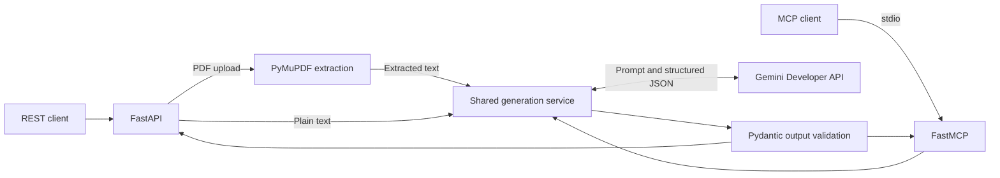

# AI-Powered eLearning Course Generator

Turn educational text or a text-based PDF into a course with three learning
objectives, four slides, and three multiple-choice questions. The REST API
serves web or script clients. A standalone MCP server lets MCP clients discover
and call tools for creating courses, making quizzes, and revising slides.

## Architecture



REST clients make HTTP requests to known URLs and receive HTTP status codes
and JSON. MCP clients perform a protocol handshake, discover tool schemas
with `tools/list`, and invoke named tools with `tools/call`. This MCP server
uses standard input and output, so it runs independently of FastAPI.

The stack is Python 3.12, FastAPI, Uvicorn, Pydantic v2, the official Google
Gen AI SDK, the official MCP Python SDK 1.x with FastMCP, PyMuPDF,
python-dotenv, pytest, and httpx.

```text
app/
  config.py          Environment settings and limits
  main.py            REST routes and input handling
  mcp_server.py      Three MCP tools served over stdio
  schemas.py         Shared Pydantic models
  services/
    gemini.py        Structured generation and bounded retry
    pdf.py           Bounded PDF text extraction
    prompts.py       Generation instructions
sample/
  sample_course.json Example validated course
tests/               Schema, service, REST, PDF, and MCP tests
```

## Installation

Install Python 3.12 and Git. Install a supported Node.js LTS release with npm
if you plan to use MCP Inspector. Run the commands from the repository root.

PowerShell:

```powershell
python -m venv .venv
. .\.venv\Scripts\Activate.ps1
python -m pip install -r requirements.txt
Copy-Item .env.example .env
```

macOS or Linux:

```bash
python3.12 -m venv .venv
source .venv/bin/activate
python -m pip install -r requirements.txt
cp .env.example .env
```

Create a key in [Google AI Studio](https://aistudio.google.com/apikey) and
edit the local `.env` file. Process environment values take precedence.

| Variable | Value |
| --- | --- |
| `GEMINI_API_KEY` | Your Gemini Developer API key |
| `GEMINI_MODEL` | A model ID available on your project, for example `gemini-3.1-flash-lite` if available on your free tier |

Check [Gemini pricing and tier availability](https://ai.google.dev/gemini-api/docs/pricing)
for your model. Keep `.env` local. Use non-sensitive material because
submitted text, including text extracted from PDFs, is sent to Gemini.

## REST API

```text
python -m uvicorn app.main:app --reload
```

Open [Swagger UI](http://127.0.0.1:8000/docs) or check
[GET /health](http://127.0.0.1:8000/health). Health checks verify that the
application is running and work without credentials.

`POST /generate-course` accepts one source and an audience of `beginner`,
`intermediate`, or `advanced`. Choose JSON or multipart in Swagger, or
use the following commands from PowerShell. The PDF example assumes you
have a text-based PDF named `lesson.pdf`.

```powershell
# JSON source
$body = @{ content = 'Python lists preserve order. Append adds an item and pop removes the last item.'; audience = 'beginner' } | ConvertTo-Json
Invoke-RestMethod -Uri http://127.0.0.1:8000/generate-course -Method Post -ContentType application/json -Body $body

# Multipart text source
curl.exe -F "content=Lists store ordered items." -F "audience=beginner" http://127.0.0.1:8000/generate-course

# Multipart PDF source
curl.exe -F "pdf=@lesson.pdf;type=application/pdf" -F "audience=intermediate" http://127.0.0.1:8000/generate-course
```

On macOS or Linux use `curl` in place of `curl.exe`. For JSON, use Swagger
or post an object such as `{"content":"Lists store ordered items.","audience":"beginner"}`.
See [sample_course.json](sample/sample_course.json) for the response shape.

## MCP server and Inspector

With the virtual environment active, run the server directly with
`python -m app.mcp_server`. A direct stdio server waits for MCP messages.
To interact with it from a browser, use the Inspector from the same shell:

```text
npx --yes @modelcontextprotocol/inspector python -m app.mcp_server
```

On Windows PowerShell, use `npx.cmd` if the execution policy blocks `npx.ps1`.
Open the local URL printed by Inspector. Choose **STDIO** if prompted and
connect using the prefilled command. Open **Tools**, list the tools, select
one, supply its arguments, and run it. Keep Inspector's local proxy token
private. For a terminal-only tool-discovery check:

```text
npx --yes @modelcontextprotocol/inspector --cli python -m app.mcp_server --method tools/list
```

| Tool | Example arguments | Result |
| --- | --- | --- |
| `generate_course` | `{"topic":"Working with Python lists","audience":"beginner"}` | Complete course |
| `generate_quiz` | `{"content":"Lists preserve order. append adds at the end. pop removes and returns the last item.","num_questions":2}` | Two questions, each with four options, an answer, and an explanation |
| `update_slide` | `{"slide_content":"The append method inserts an element at the end of the list.","instruction":"Simplify for beginners and include an example."}` | Revised title, content, and takeaway |

The SDK’s `[cli]` extra adds the `mcp` command. Its `mcp dev` command can
also launch Inspector. To use the SDK's file-based runner from the
repository root, first set `$env:PYTHONPATH = (Get-Location).Path` in
PowerShell or prefix the command with `PYTHONPATH=.` on macOS or Linux,
then run `mcp run app/mcp_server.py`. This lets the file-based runner find
the `app` package. The explicit `npx` command above starts the server with
the activated virtual environment’s Python.

## Tests

```text
python -m pytest -q
python -m pip check
```

The tests use mocked Gemini responses and locally generated PDF fixtures.
They cover REST requests, schema constraints, retry and error handling,
MCP tool calls and stdio startup, and validation of the committed sample.

## Errors, limits, and design decisions

| Status | Cause |
| --- | --- |
| 400 | Malformed multipart request or an invalid part count |
| 413 | Request or PDF exceeds its size, page, or text limit |
| 415 | Request is neither JSON nor multipart |
| 422 | Invalid fields, multiple sources, or unreadable or textless PDF |
| 429 | Gemini quota or rate limit |
| 502 | Gemini request failed or the generated output failed validation twice |
| 503 | Missing Gemini credentials or model selection |

MCP returns tool errors for invalid input or known generation failures.
Neither interface returns a sample as a fallback. The sample is an example
for browsing and tests.

The service sends a Pydantic-generated schema with the Gemini request, then
validates the response locally. Local checks enforce rules that span fields,
such as slide order and correct-answer membership. Malformed output gets
one retry. Quota and transport errors surface immediately. Synchronous
provider calls run in worker threads so they do not block the interface’s
event loop.

PDFs are limited to 10 MiB, 100 pages, and 60,000 extracted characters.
Plain text has the same character limit. Uploads may be spooled to a
temporary file by the multipart parser and are closed after processing.
Scanned documents require OCR before upload. Output can meet the schema and
still need subject-matter review. Possible extensions include OCR, source
citations, and evaluation against educator-reviewed examples.

## Four-minute demo script

1. **0:00–0:30** — Explain that REST and MCP are two interfaces around the
   same Gemini service. Start FastAPI and show the health response.
2. **0:30–1:30** — Open Swagger and submit the JSON example. Point out
   the three learning objectives, four sequential slides, and three quiz
   questions. Show the PDF upload option.
3. **1:30–3:15** — Open Inspector, connect over stdio, and list the three
   tools. Run the course, quiz, and slide examples. Compare the MCP course
   output with the REST output and show the quiz question count.
4. **3:15–4:00** — Show `app/services/gemini.py` and `app/schemas.py`.
   Explain the local validation and one retry, then show the pytest result.
   If Gemini quota interrupts the demo, show the actual error and use the
   labeled example JSON to illustrate the output structure.
